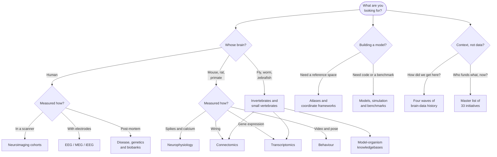

# Brain Data: A Field Guide to Neuroscience Archives

Whether you're a new lab/student with a tight budget, a modeller looking for something real to fit, or a researcher with recordings that need a comparison cohort: **the data you need probably already exists, but you are not sure where to find it**. 

The scale of what is sitting there is easy to underestimate. Every synapse in a fruit fly's brain — all 140,000
neurons and roughly 50 million connections — has been reconstructed and published. So has a cubic millimetre of mouse
visual cortex in which 200,000 cells each come with a recording of what they did while the animal watched a movie.
Brain scans from 100,000 people. Gene expression for all 302 neurons of a nematode, measured one neuron at a time.

The hard part isn't whether the data exist, it is that they sit in many separate
portals, each with its own login, licence, file format and vocabulary, and no two of them agree on what to call a
brain region.

**This site is the map.** Part I is the history of how the field has evolved. Part II is where everything lives and what it takes to get in. 

## Find your way in

Start from what you actually want to measure:

Now pick the matching door:

-   :material-brain: **Human brains**

    [Neuroimaging cohorts](resources/human-neuroimaging.md) · [EEG, MEG and iEEG](resources/human-electrophysiology.md) ·
    [Disease, genetics and biobanks](resources/disease-genetics.md)

-   :material-rodent: **Animal brains**

    [Neurophysiology](resources/neurophysiology.md) · [Connectomics](resources/connectomics.md) ·
    [Behaviour and pose](resources/behavior.md) · [Model organisms](resources/model-organisms.md)

-   :material-dna: **Molecules and cells**

    [Transcriptomics and spatial omics](resources/transcriptomics.md) ·
    [Organoids and stem cells](resources/organoids.md)

-   :material-cube-outline: **Building something**

    [Atlases and coordinate frameworks](resources/reference-atlases.md) ·
    [Models and benchmarks](resources/models.md) · [Standards and tooling](resources/standards-catalogs.md)

-   :material-database-search: **No idea where to start**

    [Federated archives](resources/federated-archives.md) — the general-purpose ones. For most modalities, one of
    these already has what you want.

-   :material-timeline-clock: **Here for the story**

    [Four waves of history](history/index.md) · [National initiatives](history/national-initiatives.md) ·
    [Foundation models](history/foundation-models.md) · [Outlook](history/outlook.md)

## The short version

If you read nothing else, these three things shape everything in the list:

- **The plumbing works.** Open archives like OpenNeuro, DANDI and EBRAINS are alive and growing, and the shared
  formats underneath them — BIDS for imaging, NWB for neurophysiology — are what let you download somebody else's
  experiment and actually open it. They are now also what makes AI models of the brain trainable at all.
- **The megaprojects turned into furniture.** The billion-euro EU Human Brain Project became EBRAINS. Blue Brain
  closed and became the Open Brain Institute. Japan's Brain/MINDS became Brain/MINDS 2.0. The ten-year moonshot has
  given way to permanent infrastructure, which is less thrilling and considerably more useful.
- **The money is moving east.** US BRAIN funding is below its 2023 peak and faces a cliff after FY2026, while China
  and Japan expand. Canada and Australia have mature national strategies and no national budget behind them.

## Two halves, two questions

Plenty of things appear in both parts of this site — EBRAINS is simultaneously a 2019 EU initiative and an archive you
can download from this afternoon. Nothing is described twice; which half you want depends on your question:

| Your question | Where it is answered |
|---|---|
| When did it start, who paid for it, is it still funded? | [History](history/index.md) |
| What does it hold, for which species, and how do I get in? | [Resource list](resources/index.md) |

## Before you download anything

Check the **Access** column first. It is the difference between an afternoon and a quarter. Four tiers show up across
the list: *fully open* (click and download), *registration* (free account), *data-use agreement* (a signature, no
review), and *controlled access* (committee review, often weeks, sometimes an institutional signing official).

Roughly: the invertebrate connectomes and the Allen atlases are open; the big human cohorts are not.
