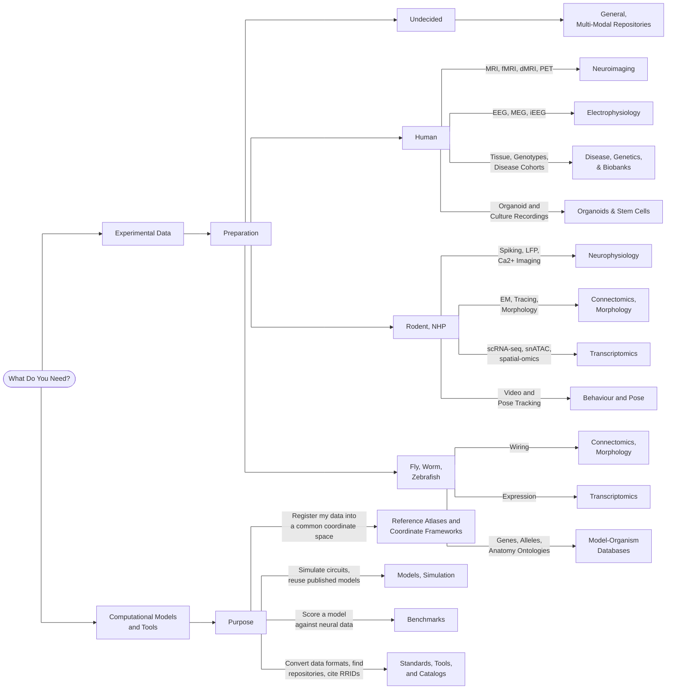

# NeuroArchives: A Field Guide to Neuro Data & Resources

*Created October 2026 · @Laura M*

If you're starting a project with a tight budget, looking for experimental data to model/analyze, or needing a comparison cohort: **the data you need probably already exist and this guide will help you find it.** 

The scale of data that is already publicly available is easy to underestimate. Every synapse in a fruit fly's brain (all 140,000
neurons and roughly 50 million connections) has been reconstructed and published. So has a cubic millimetre of mouse
visual cortex in which 200,000 cells each come with a recording of what they did while the animal watched a movie.
Brain scans from 100,000 people. Gene expression for all 302 neurons of a nematode, measured one neuron at a time.

The hard part is that this data sits in many separate portals, 
each with its own login, licence, file format, and vocabulary.

**This site is the map.**

-   :material-timeline-clock: **[Part I — History](history/index.md)**

    ---

    A short overview of how the open neuroscience data field has evolved: four waves from 1990s neuroinformatics to
    today's brain foundation models, the national initiatives behind them, and what remains funded.

    [:octicons-arrow-right-24: Read the history](history/index.md)

-   :material-database-search: **[Part II — Resource List](resources/index.md)**

    ---

    Where that data lives and how to access it: archives, atlases, cohorts and benchmarks across different categories,
    each with host, species, technique, biological level and access terms.

    [:octicons-arrow-right-24: Browse the resource list](resources/index.md)

## Finding your resource

### Experimental Data

-   **Human**
  
    [Neuroimaging](resources/human-neuroimaging.md) ·
    [Electrophysiology](resources/human-electrophysiology.md) ·
    [Disease, Genetics, & Biobank Portals](resources/disease-genetics.md) ·
    [Organoids & Stem Cells](resources/organoids.md)

-   **Animal (Rodent, NHP)**
  
    [Neurophysiology](resources/neurophysiology.md) ·
    [Connectomics & Morphology](resources/connectomics.md) ·
    [Transcriptomics & Spatial -omics](resources/transcriptomics.md) ·
    [Behaviour & Pose Estimation](resources/behavior.md)

-   **Invertebrate and Small Vertebrate**
  
    [Connectomics](resources/connectomics.md) · [Transcriptomics](resources/transcriptomics.md) ·
    [Model-Organism Databases](resources/model-organisms.md)

-   **General-Purpose Archives**
  
    [Multi-Modal Repositories](resources/federated-archives.md) (federated, standards-based archives
    holding data from many labs).

### Models & Tools

-   **[Computational Models & Simulation](resources/models.md)**
  
    Published model code (ModelDB, Open Source Brain) and the simulators to run it (The Virtual Brain, NetPyNE, Arbor).
    
-   **[Benchmarking](resources/benchmarks.md)**
  
    Leaderboards, held-out challenge splits, and the datasets the field uses as common test sets, cross-listed from
    their home categories.
    
-   **[Reference Atlases & Coordinate Frameworks](resources/reference-atlases.md)**
  
    The coordinate spaces everything else registers into: Allen CCFv3, Julich-Brain, BigBrain, Waxholm, TemplateFlow.
    
-   **[Formats, Converters, Standards](resources/standards-catalogs.md)**
  
    Data formats (NWB, BIDS, DataLad and openMINDS), plus the registries for finding resources and checking they are still maintained.

## State of the Field

Three observations have come from compiling these resources and intiatives:

1. **Open data sharing is working.** Open archives (OpenNeuro, DANDI, EBRAINS) and the shared formats beneath
  them (BIDS for imaging, NWB for neurophysiology) are active and growing, and now also serve as the training substrate
  for pooled models of neural activity.
2. **Megaprojects have converted into permanent infrastructure.** The EU Human Brain Project ended in 2023 and was
  succeeded by EBRAINS; Blue Brain closed in 2024 and its assets moved to the Open Brain Institute; Japan's Brain/MINDS
  became Brain/MINDS 2.0.
3. **Funding is shifting.** US BRAIN funding sits below its 2023 peak and its 21st Century Cures Act component ends
  after FY2026, while China and Japan are expanding. Canada and Australia have mature national strategies without
  dedicated national budgets.

## Before Downloading Data...

Check the **Access** column first. Four tiers show up across the list: *fully open* (click and download), *registration* (free account), *data-use agreement* (a signature, no
review), and *controlled access* (committee review, often weeks, sometimes an institutional signing official).
