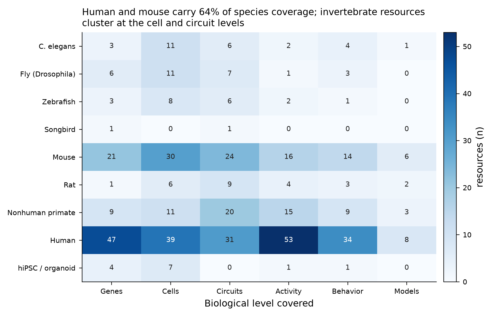

# Open neuroscience data resources

**188 resources** across 13 categories, spanning *C. elegans* to human, molecules to behaviour. Each entry records what
the data are, who hosts them, the access conditions and the URL.

Machine-readable version: [`data/neuroscience_data_resources.csv`](https://github.com/lauramedlock/neuroarchives/blob/main/data/neuroscience_data_resources.csv)
— columns: Category, Resource, Host, Region, Species, Technique, Level, Description, URL, Access. Every page in this
section is generated from that file.

## How to navigate it

- **Looking for recorded neural activity?** Try [DANDI](federated-archives.md) first, then
  [CRCNS](federated-archives.md), then the lab portal.
- **Looking for human imaging?** [OpenNeuro](federated-archives.md) for individual studies, the
  [cohort portals](human-neuroimaging.md) for population-scale.
- **Looking for a connectome?** [FlyWire (fly), MICrONS (mouse cortex), H01 (human cortex), WormWiring (*C. elegans*),
  Allen Connectivity (mouse mesoscale)](connectomics.md).
- **Looking for cell types?** The [ABC Atlas](reference-atlases.md) and [CELLxGENE](transcriptomics.md) cover most of
  what exists.
- **Can't find it here?** Search [Neuroscience Information Framework](https://neuinfo.org) or
  [re3data](https://www.re3data.org).

!!! info "Access labels"
    The **Access** column distinguishes *fully open* (download now), *registration* (free account), *data-use
    agreement* (signature, no review), and *controlled/application* (committee review, often weeks).

## Coverage

Counts are resource tags, not dataset counts; a resource spanning three species and two levels contributes six tags.
18 cross-cutting resources (general repositories, standards, catalogs) are excluded from the figure because they apply
to every species and level, as are the three resources merged in from the history document — so the heatmap reflects
the 185 resources of the original compilation. The pattern is the real state of the field: human and mouse carry 64% of
species coverage, invertebrate resources are strongest at the cell and circuit levels (where complete connectomes
exist), and explicitly model-oriented resources are the scarcest category in every species.

## Categories

<!-- BEGIN:category-index (generated by scripts/build_resource_pages.py) -->

| Category | Resources |
|---|---|
| [Federated archives & multi-modal repositories](federated-archives.md) | 26 |
| [Reference atlases & coordinate frameworks](reference-atlases.md) | 20 |
| [Transcriptomics, epigenomics & spatial omics](transcriptomics.md) | 20 |
| [Connectomics, projections & neuron morphology](connectomics.md) | 23 |
| [Neurophysiology & neural activity (animal)](neurophysiology.md) | 10 |
| [Human electrophysiology (EEG / MEG / iEEG)](human-electrophysiology.md) | 8 |
| [Human neuroimaging cohorts & population studies](human-neuroimaging.md) | 24 |
| [Behavior, video & pose datasets](behavior.md) | 11 |
| [Computational models, simulation & benchmarks](models.md) | 13 |
| [Organoids, stem cells & in-vitro models](organoids.md) | 6 |
| [Model-organism knowledgebases](model-organisms.md) | 7 |
| [Disease, genetics & biobank portals](disease-genetics.md) | 11 |
| [Standards, tooling & resource catalogs](standards-catalogs.md) | 9 |
| **Total** | **188** |

<!-- END:category-index -->

---

Compiled October 2026. URLs and access conditions were not re-verified against the live sites at compile time; hosts
occasionally reorganize portals, so treat a dead link as a redirect to look up rather than a retired resource.
Consortium data holdings grow continuously — sizes quoted here are the figures reported at the latest release known to
this compilation.
